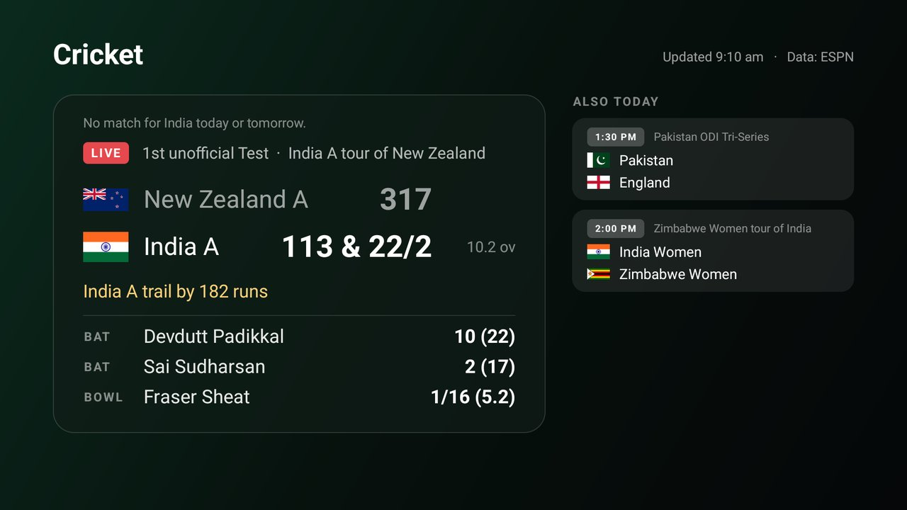

# Cricket

Live cricket on the TV, full screen: your team's match in a big card and today's other international
matches beside it. For the [Clean Your TV](../../README.md) launcher it declares a
[module card](../../docs/modules.md), so once you answer **Show card** its tile reads "Cricket" with a green
glow; on any other Android TV home it is an ordinary app.



- **The big card** follows India and the IPL by default (see Options). A live match shows both scores with
  overs, the line ESPN writes ("India need 42 runs from 30 balls"), the two batters at the crease and the
  bowler of the latest ball. A match starting within 18 hours shows its start time in the TV's clock
  format; a finished one shows the result with the top scorer and the best bowling. On a day your team
  rests, the card shows the top live international match and says so.
- **Also today** lists up to four other matches with a Test-playing nation (or its A, women's or under-19
  side), live first. Down and Up move through them, OK moves one into the big card, Back puts your team's
  match back and then leaves.
- **Flags** for 19 national sides are bundled (flat, public domain, from [flagcdn.com](https://flagcdn.com));
  other teams get a circle with their first letter. No team logos are downloaded.
- **Data** is ESPN's public cricket scoreboard and match summary (`site.web.api.espn.com`), which need no
  account or key. They are unofficial, so failures are soft: the last scores stay on screen and the header
  says "Not updating since" with the time.

## How often it asks

Only while the page is on screen; leaving it stops everything. One request at a time, gzip (about 9 KB for
a scoreboard, 22 KB for a match):

| What | How often |
|---|---|
| Today's scoreboard | every 5 minutes while a listed match is live, every 15 otherwise |
| Tomorrow's scoreboard | only when your team is not live or starting soon, at most every 3 hours |
| The big card's match | every minute while it is live, every 15 minutes while play has stopped (stumps, rain, a break), once for a result, never before it starts |
| After a failure | 1, 2, 4, 8 minutes, then every 15 |
| ESPN answers 429 or 503 | nothing for at least 30 minutes, or its `Retry-After` if longer (up to 6 hours) |

## Options

Set in `app/src/main/res/values/options.xml` before building.

| Option | Default | What it does |
|---|---|---|
| `follow_teams` | `India` | The teams for the big card, by ESPN's name (`Pakistan`, `New Zealand`, `West Indies`...), comma-separated. A live match wins; otherwise the first team in the list does. |
| `follow_women` | `false` | Also follow the women's side of those teams (`India Women`). |
| `follow_ipl` | `true` | Also follow the Indian Premier League. |

## Permissions

| Permission | Why |
|---|---|
| `INTERNET` | ESPN's cricket scoreboard and match summaries. |

That is all. Nothing is sent except the request for the day's scoreboard or one match; no account, no
telemetry, no ads, no background service, no location. Scores are kept in memory only (backups are off).

## Build and install

JDK 17 and Android SDK platform 34 with build-tools 34.0.0, as for the launcher:

```bash
cd addons/cricket && ./gradlew assembleRelease
TV_HOST=<tv ip> ../../tools/venv/bin/python -I ../../tools/tv.py --push app/build/outputs/apk/release/app-release.apk /data/local/tmp/addon.apk
TV_HOST=<tv ip> ../../tools/venv/bin/python -I ../../tools/tv.py 'pm install -r /data/local/tmp/addon.apk; rm -f /data/local/tmp/addon.apk'
```

Press Home: the launcher asks once whether to show the card. Change the answer later by holding OK on
Settings, then Module cards.

The release build is signed with the debug key so it installs over ADB like the launcher. Sign your own builds
with your own key if you hand them out; the launcher pins its Show answer to the signing key.

The parsing and the choice of match have JVM tests: `./gradlew testReleaseUnitTest`.

## Tested on

Sony BRAVIA 4K VH2 (KD-55X80J), Google TV 12 / Android 12: the page with a live India A Test (batters and
bowler), an upcoming ODI moved into the big card with OK and back with Back, and the list. The card prompt
was not tried on this TV, which runs a different home screen.

## Maintainer

[@udeshvirk](https://github.com/udeshvirk)
